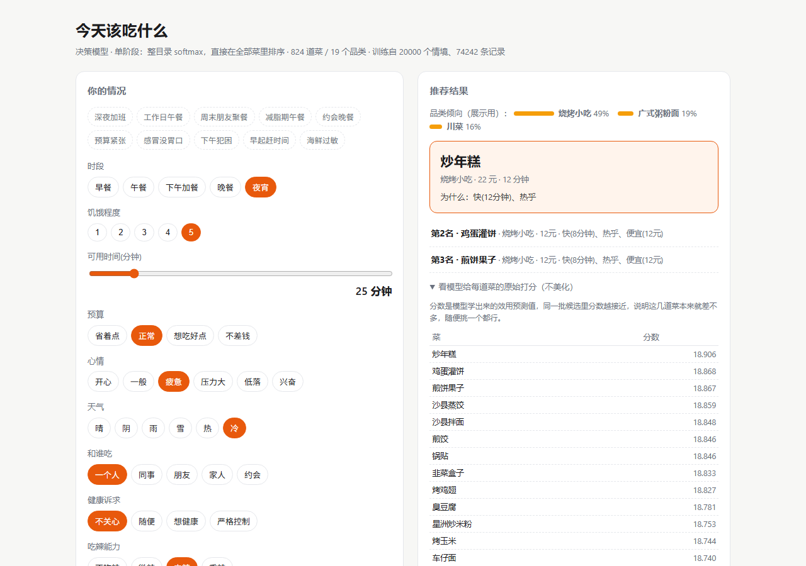

# 前端交接文档 —— EATWHAT-model（吃什么）

> 写给**下一个要改界面的会话**。本文件只讲前端：代码在哪、怎么改、怎么验收、
> 有什么坑、哪些地方值得先优化。
>
> 快照时间：2026-11-05。后端/模型侧的历史与结论见 [`交接文档.md`](交接文档.md)，别重复读。

---

## 0. 30 秒速览

| 项 | 值 |
|---|---|
| 前端在哪 | **`app/server.py` 第 249–534 行的 `PAGE = r"""..."""`** —— 整站 HTML/CSS/JS 一个字符串 |
| 技术栈 | 原生 HTML + CSS + 原生 JS。**没有框架、没有构建步骤、没有 npm、没有 CDN** |
| 外部依赖 | **零**。断网也能跑（这是项目的硬要求） |
| 代码量 | 前端约 280 行（CSS ~75 行 / HTML ~25 行 / JS ~180 行） |
| 改完怎么生效 | **重启 `python server.py`**，没有热更新；浏览器强刷（服务端已带 `Cache-Control: no-store`） |
| 怎么验收 | `python app/snapshot_ui.py` → `ui_snapshot.html` → 截图（命令见 §1.3） |
| 当前截图 | [`app/artifacts/ui_shot.png`](../app/artifacts/ui_shot.png) |
| 最大的待办 | **P0：`all_scores` 把全部 824 道菜塞进页面**（见 §5.1） |

---

## 1. 怎么跑、怎么改、怎么验收

### 1.1 起服务

```bat
cd app
python server.py --no-browser      :: 不让它自动开浏览器
:: 浏览器打开 http://127.0.0.1:8848/
```

正常用户走 `启动.bat`（会先跑 `preflight.py` 自检，然后开浏览器）。开发时用
`--no-browser` 更省事。停止：`停止服务.bat`，或直接关掉那个命令行窗口。

> 端口固定 **8848**。要换端口用 `--port 9000`，但 `snapshot_ui.py` 里写死了 8848，
> 换端口后它连不上。

### 1.2 改哪里

全部改动都落在 `app/server.py` 的 `PAGE` 字符串里：

| 想改 | 位置（当前行号） |
|---|---|
| 配色 / 间距 / 暗色模式 | `PAGE` 顶部 `<style>`，CSS 变量 `:root{...}`（L253 起） |
| 页头标题与副标题 | `<header>`（L327） |
| 左侧「你的情况」卡片 | `<section class="card">`（L334） |
| 右侧「推荐结果」卡片骨架 | `<section class="card">`（L346） |
| 表单渲染逻辑 | `boot()` 里的 `META.fields.forEach`（L375 起） |
| 提交请求 | `run()`（L465） |
| 结果渲染 | `draw()`（L483） |
| 后端返回什么 | `def predict()`（L64） |

### 1.3 验收（三条，都要过）

```bat
:: ① 接口没坏：返回 200，且字段齐全（见 §2.2）
cd app
python -c "import json,urllib.request as u; b=json.dumps({'time_slot':'午餐','hunger':3,'available_time':30,'budget':'正常','mood':'一般','weather':'热','companion':'一个人','health_goal':'严格控制','spicy_tol':'微辣','taboo':''}).encode(); r=u.Request('http://127.0.0.1:8848/api/predict',b,{'Content-Type':'application/json'}); d=json.loads(u.urlopen(r).read()); print(d['stage'], len(d['items']), len(d['all_scores']), d['items'][0]['dish_name'])"

:: ② 静态快照能渲染出完整界面（服务必须在跑）
python snapshot_ui.py
:: 产出 artifacts/ui_snapshot.html，会顺带打印首推菜名

:: ③ 截图看视觉（回到项目根目录）
python "C:\Users\123\.dsh\skills\vision-tools\scripts\html_shot.py" ^
       "app\artifacts\ui_snapshot.html" --width 1280 --height 900 -o "app\artifacts\ui_shot.png"
```

> `html_shot.py` 是本地 vision 工具（headless Chrome/Edge 渲染），不在本项目里。
> 没有它就用浏览器手动截图，或 `--dump-dom` 看渲染后的 DOM。

**改完前端必做的回归**：`python recommend.py --all-presets`（走的是同一套模型，
但它验证的是命令行侧；界面侧主要看 ①②③）。

---

## 2. 后端接口契约（前端唯一的信息来源）

### 2.1 `GET /api/meta` —— 首屏加载一次

```jsonc
{
  "fields": [                       // 10 个情境字段，**界面按数组顺序渲染**
    {"key": "time_slot",  "label": "时段",       "options": ["早餐","午餐","下午加餐","晚餐","夜宵"]},
    {"key": "hunger",     "label": "饥饿程度",    "options": ["1","2","3","4","5"]},
    {"key": "available_time", "label": "可用时间(分钟)", "options": []},   // 空数组 = 用滑块
    {"key": "budget", "label": "预算", "options": ["省着点","正常","想吃好点","不差钱"]},
    {"key": "mood", "label": "心情", "options": ["开心","一般","疲惫","压力大","低落","兴奋"]},
    {"key": "weather", "label": "天气", "options": ["晴","阴","雨","雪","热","冷"]},
    {"key": "companion", "label": "和谁吃", "options": ["一个人","同事","朋友","家人","约会"]},
    {"key": "health_goal", "label": "健康诉求", "options": ["不关心","随便","想健康","严格控制"]},
    {"key": "spicy_tol", "label": "吃辣能力", "options": ["不吃辣","微辣","中辣","重辣"]},
    {"key": "taboo", "label": "忌口（可留空）", "options": ["","海鲜","乳制品","麸质","花生","海鲜,乳制品","素食"]}
  ],
  "dishes": [{"id": 0, "name": "番茄牛腩饭", "category": "煲仔饭碟头饭"}, /* …共 824 条 */],
  "presets": {"深夜加班": {"time_slot":"夜宵","hunger":5, /* 10 个字段 */}, /* …共 10 个 */},
  "stats": {"n_dishes": 824, "n_categories": 19, "n_scenarios": 20000, "n_rows": 74242},
  "stage": "single"                 // "single" = 单阶段整目录 softmax；"two_layer" = 两层
}
```

⚠️ `taboo` 的 `options` 里**第一个是空字符串**，表示「无忌口」。前端把它显示成
「无忌口」五个字，但提交时**要发空串**。

### 2.2 `POST /api/predict` —— 每次点「给我推荐」

**请求体**：`META.fields` 里 10 个 key 一个不少（值必须是 `options` 里的**原样字符串**），
外加两个可选参数：

```jsonc
{ "time_slot":"午餐", "hunger":3, "available_time":30, "budget":"正常", "mood":"一般",
  "weather":"热", "companion":"一个人", "health_goal":"严格控制", "spicy_tol":"微辣", "taboo":"",
  "exclude": ["牛油果吐司"],   // 手动排除的菜名（精确匹配，来自 META.dishes 的 name）
  "topk": 5 }                 // 1~10，超出会被夹紧
```

**响应**（真实抓包，`topk=3` 时）：

```jsonc
{
  "scenario": { /* 回显，已规范化 */ },
  "stage": "single",
  "cuisine_top": [{"name":"面包甜点","prob":0.4439}, …],   // 最多 3 个，概率和不为 1
  "candidates": 824,          // 参与打分的菜数（单阶段=824；两层=该品类菜数）
  "excluded": 0,              // **只统计手动 exclude，不含忌口**（忌口由模型自己躲开）
  "items": [{
      "rank": 1, "dish_name": "牛油果吐司", "category": "面包甜点",
      "prob": 0.4439,         // 头部 10 名内归一化后的相对概率（展示用）
      "match": 0.4439,        // 与 prob 相同，历史遗留字段，可直接忽略
      "score": 19.2726,       // 模型原始分：**未校准、跨次不可比**，只用于同一次内部排序
      "reason": "快(6分钟)、够健康",   // 后端生成的解释短语，可直接展示
      "price": 28, "time_cost": 6, "spicy": 0,
      "healthy": 5, "heavy": 2, "temperature": 1   // 属性原文，可用来画小标签
  }],
  "all_scores": [{"dish_name":"牛油果吐司","score":19.273}, …],   // ⚠️ 单阶段下有 824 条
  "truth": {"model_top1_utility":0.5758, "best_possible":0.5758, "best_dish":"牛油果吐司"}
             // 规则下的「上帝视角」对照；算出错时是 null
}
```

**四件容易踩的事**：

1. **枚举值不合法不会报错**，服务端会**静默回落到第一个选项**
   （`if v not in CTX_VOCAB[field]: v = CTX_VOCAB[field][0]`）。
   所以「看起来点了但结果是错的」通常是这里 —— 前端必须发 `options` 里的原样字符串。
2. `hunger` / `available_time` 必须是数字，`available_time` 会被 `int()` 转换。
3. `exclude` 是**菜名数组**，不是 id。
4. `all_scores` 在单阶段下是全部 824 道菜 —— 这是 P0 问题，见 §5.1。

---

## 3. 前端现状

### 3.1 DOM 骨架

```
body
├─ header
│   ├─ h1「今天该吃什么」
│   └─ .sub  ← #stage-label（当前模型结构） + #stats（菜品/情境统计）
└─ .wrap  (grid: 1.05fr 1fr，<880px 变单列)
    ├─ section.card #1「你的情况」
    │   ├─ .presets#presets        ← 10 个预设按钮（dashed 胶囊）
    │   ├─ #form                   ← 10 个 .field，由 boot() 动态生成
    │   │   └─ .field × 10        （label + .seg 按钮组 / input[type=range]）
    │   ├─ button.go#go「给我推荐」
    │   └─ details                 ← 「不想吃的东西」折叠面板
    │       └─ .chips#chips        ← 824 个菜品按钮（点一下排除/恢复）
    └─ section.card #2「推荐结果」
        └─ #out
            ├─ .cuisine            品类倾向（带 .bar 横条）
            ├─ .pick               第 1 名大卡片（品牌色描边 + 浅底）
            ├─ .alt × (topk-1)     第 2 名起
            ├─ details             原始打分表（824 行）
            └─ .truth              上帝视角对照（仅当 truth 非 null）
```

### 3.2 设计 token（都定义在 `:root`，暗色模式是 `prefers-color-scheme`）

| 变量 | 浅色 | 用途 |
|---|---|---|
| `--bg` | `#f7f7f5` | 页面底色 |
| `--card` | `#fff` | 卡片底 |
| `--ink` | `#1c1c1e` | 正文 |
| `--muted` | `#6b7280` | 次要文字 |
| `--line` | `#e5e7eb` | 描边/分隔线 |
| `--brand` | `#e8590c` | 品牌橙：主按钮、选中态、第一名卡片描边 |
| `--brand-soft` | `#fff4ec` | 第一名卡片底色 |
| `--bar` | `#f59e0b` | 品类倾向小横条 |

字号：正文 15px/1.6，标题 24px，卡片标题 15px，辅助 12–13px。
布局：`max-width:1080px`，卡片圆角 14px，主按钮圆角 10px，胶囊按钮 `999px`。

### 3.3 三个全局状态

```js
let META=null,   // /api/meta 的完整响应，只加载一次
    ST={},       // 当前选择的情境（10 个字段），初始取 presets['工作日午餐']
    EX=new Set();// 手动排除的菜名，Set<string>
```

**没有状态管理库，也没有渲染框架** —— `render()` 把 ST 同步到控件，`draw()` 重建结果区。
一切靠 DOM 直接操作。

### 3.4 四个函数的职责

| 函数 | 干什么 | 什么时候调 |
|---|---|---|
| `boot()` (L361) | 拉 meta、铺预设/表单/菜品 chips、绑事件、写页头统计 | 页面加载尾部 `boot()` |
| `render()` (L435) | 把 `ST` 的值同步回已有控件（改预设时用） | 点预设后、autorun 后 |
| `run()` (L465) | POST `/api/predict`，按钮转圈，成功后 `draw(d)` | 点「给我推荐」、点预设 |
| `draw()` (L483) | 用响应重建 `#out` 整块 | `run()` 成功后 |

### 3.5 一条给自动化的旁路

```js
window.addEventListener('message', ev => { if (ev.data?.type === 'autorun') { … render(); run(); } })
```

外部页面（或测试脚本）可以 `postMessage({type:'autorun', preset:'减脂期午餐'})`
直接触发一次推荐。**改前端时别删**，截图/联调脚本可能依赖它。

---

## 4. 当前视觉长什么样



（1280×900 截图，`深夜加班` 预设、已出结果的状态）

要点：浅灰底 + 白卡片；品牌橙只用在「选中态 / 主按钮 / 第一名卡片」三处；
左栏是输入（预设 → 10 个字段 → 主按钮 → 折叠的排除区），右栏是结果（品类倾向 → 第一名大卡 → 第 2 名起列表 → 折叠的原始打分）。

---

## 5. 已知问题（改之前先看这里）

按建议修复顺序排列。每条都给了位置和改法方向。

### P0-1 `all_scores` 把 824 道菜全塞进页面

**现象**：结果区的「看模型给每道菜的原始打分」展开后是 **824 行表格**，页面被拉到几十屏；
单次响应 **34 KB**，其中 95% 是这个表。
**根因**：换成单阶段模型后 `cand` 从「一个品类约 43 道」变成了全部 824 道
（`app/server.py` `predict()` 里的 `cand = np.arange(N_DISH)`），`all_scores` 直接跟着膨胀。
**改法方向**（任选，前端就能做）：
- 表格只取 `all_scores.slice(0, 20)`，标题改成「头部 20 名」；
- 或者改成「与第 1 名的差距」视图，只显示差距 < 0.3 的菜；
- 或者干脆把这块降级成「下载全部打分（JSON）」。
**注意**：后端也可以限量，但那是模型侧的事，最好写进 `交接文档.md` 的待办，别在本文档里改后端。

### P0-2 忌口面板一次生成 824 个按钮

**现象**：`boot()` 里 `META.dishes.forEach` 给每道菜建一个按钮，**页面一加载就多 824 个 DOM 节点**，
而且用户要在这堆按钮里找「牛油果吐司」。
**改法方向**：改成**搜索框 + 下拉候选**（输入即筛），或按品类分组折叠。
`EX` 的语义不用变，只是选择方式变了。

### P1-1 原始评分对用户没有意义

**现象**：分数是 `18.906 / 18.868 / 18.867` 这种，未校准、跨次不可比。
用户看不懂「18.9 分」是什么意思，也看不出第 1 名比第 2 名好多少（其实只差 0.038）。
**改法方向**：
- 显示「与第 1 名的差距」（`score - top1.score`，越接近 0 越接近），或
- 直接换成 `truth` 里的**效用**口径（0~1，可与「规则下的最优」比），或
- 只显示一个相对条（用 `prob` 画）。
**注意**：`score` 绝对值没有意义，别拿它当「匹配度百分比」。

### P1-2 没有「再来一个 / 换一个」

**现象**：结果出来后只能改条件重算，或者点菜品排除。
**改法方向**：在第一名卡片旁加「不想吃这道 → 排除并重算」（把菜名塞进 `EX`，直接 `run()`）。
后端已经支持 `exclude`，**零后端改动**。

### P1-3 可访问性基本没做

- 分段按钮没有 `aria-pressed`，读屏软件读不出「已选中哪个」；
- 没有 `:focus-visible` 样式，键盘 Tab 看不到焦点；
- `.bar` 只有视觉长度，没有文字等价值；
- 颜色不是唯一信息源（选中态同时有底色，OK），但对比度未验证。

**改法方向**：给 `.seg button.on` 加 `aria-pressed="true"`，加 `:focus-visible{outline:2px solid var(--brand)}`。

### P2-1 `render()` 靠 DOM 顺序对齐 `META.fields`

```js
document.querySelectorAll('#form .field').forEach((box,i)=>{ const f = META.fields[i]; … })
```

**隐患**：一旦在表单里插入/删除一个非字段元素（比如加个分隔标题），下标就对不上，
表现为「换预设时选中的是别的按钮」，而且**不会报错**。
**改法方向**：给每个 `.field` 加 `dataset.key = f.key`，按 key 查而不是按 index。

### P2-2 结果区没有加载态

点「给我推荐」时只有按钮里一个转圈，右侧结果区保持旧内容（或空白提示），
用户不知道「是不是点了」。**改法**：`#out` 里放骨架屏或「正在算…」。

### P2-3 `truth` 暴露了「上帝视角」

结果底部会显示「规则下的最优是 X，本次首推效用 0.5758」。
这是项目**刻意**做的透明化（相信用户能自己判断推荐好不好），但产品化时要想清楚要不要展示。

### P2-4 错误只有一行字

`catch` 里把 `e.message` 直接塞进 `#out`。服务挂了 / 端口被占时的提示对用户没有指导性。

---

## 6. 改前端时的硬约束

1. **离线、零依赖**。不能引 Tailwind/Bootstrap/React 的 CDN，也不能加 npm 构建。
   项目定位是「纯本地、不联网」—— 这条不能破。要引第三方库，必须把文件**内联或放进仓库**。
2. **`PAGE` 是 Python 的 `r"""…"""` 原始字符串**：
   - 里面**不能出现 `"""`**；
   - 反斜杠是字面量（写 `\n` 在 JS 里就是两个字符，正则要小心）；
   - `{` `}` 没有特殊含义（不是 f-string），可以随便用。
3. **枚举值必须与后端完全一致**（见 §2.2 第 1 条）。中文全角/半角、空格都会导致静默回落。
4. 服务端所有响应都带 `Cache-Control: no-store`，改完刷新即可，不用管缓存。
5. **没有热更新**：改 `PAGE` 后必须重启 `python server.py`。
6. 文件编码 UTF-8（不要存成 GBK）。只有 `.bat` / `.vbs` 有 GBK 的坑，见 `交接文档.md` §4.3。
7. `snapshot_ui.py` 用**精确字符串替换**往页面里打补丁：

   ```python
   html.replace("META = await (await fetch('/api/meta')).json();", "META = __SNAP_META__;")
   html.replace("ST = {...META.presets['工作日午餐']};", "ST = {...META.presets['深夜加班']};")
   html.replace("document.getElementById('go').onclick = run;", "…")
   ```

   **这些 `replace` 找不到目标时是静默 no-op**。你一旦改写这几行，
   快照会悄悄变成「空表单」或「预设没选中」，而脚本不会报错。
   改前端后**一定要打开 `ui_snapshot.html` 的眼力验收截图**，别只看它打印的成功信息。
8. **所有动态内容都是 `innerHTML` 拼接，没有转义**。菜名/品类名来自本地
   `dishes.csv`，现在都可控；但**一旦接入任何外部输入（用户自建菜品、URL 参数、
   剪贴板），必须先转义**，否则就是 XSS。要省事就换成 `textContent` + `createElement`。
9. `tooling/_dump_dom.py` 里的路径是**坏的**（指向 `meal-decision\artifacts\`，实际在
   `EATWHAT-model\app\artifacts\`）。要用 DOM dump 就先修路径，别以为是环境问题。

---

## 7. 建议的推进顺序

1. **先修 P0-1 / P0-2**（页面长度与首屏 DOM 重量）。这两条不改，任何视觉迭代都会被
   「页面有几十屏」淹没。
2. **再改信息层次**：`score` → 可解释的量（相对差距 / 效用 / 相对条），
   并补上 P1-2 的「换一个」。
3. **然后才是视觉**：排版节奏、暗色模式细化、移动端。
4. 如果要大改结构（拆成 `static/index.html` + `server.py` 提供静态文件），
   记得同步 `snapshot_ui.py` 的三处 `replace`，以及 `启动.bat` / `preflight.py`
   对文件布局的假设（它们只关心 `app/server.py` 和 `app/artifacts/`）。

---

## 8. 相关文件

| 文件 | 作用 |
|---|---|
| `app/server.py` | 前端全部代码（`PAGE`）+ 两个接口 + 启动入口 |
| `app/snapshot_ui.py` | 把真实界面渲染成静态快照（验收视觉用，注意 §6.7 的坑） |
| `app/artifacts/ui_shot.png` | 当前界面截图（README 引用，改完请重新生成） |
| `app/artifacts/ui_snapshot.html` | 快照中间产物（`.gitignore` 已忽略） |
| `app/recommend.py` | 命令行版推荐，`--all-presets` 抽查用；`why()` 生成解释短语 |
| `app/features.py` | `CTX_VOCAB` / `DISH_VOCAB` —— 所有合法枚举值的唯一来源 |
| `docs/交接文档.md` | 后端与模型侧的交接（结构、指标、踩过的坑） |
| `tooling/_dump_dom.py` | DOM dump 工具（路径已坏，用前先修） |
